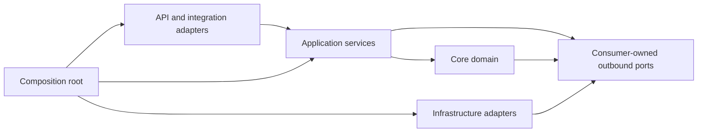

# PROXI architecture

## Repository audit

The starting worktree contained project instructions and two agent documents. There were no application sources, backend or frontend dependency manifests, runtime configuration, tests, or database files. The existing instructions remain in place and define the fixed stack, domain vocabulary and issue workflow. No existing implementation was available to reuse or to reconcile with the requested boundaries. The requested infrastructure directories use `backend/app/infra/`, not a second `infrastructure/` package.

## Six logical layers

| Layer | Responsibility | Home |
| --- | --- | --- |
| Experience | Dashboard, controlled browser UI and Chrome extension | `frontend/` for the Next.js shell; other UIs planned |
| Integration | Translate browser, MCP and local agent requests into application calls | `backend/app/integrations/` |
| Identity & Authorization | Establish agent identity, session validity, credential state and capability scope | `core/{identity,sessions,creds,capabilities}` |
| Intelligence & Trust | Interpret intent, analyze behavior and assess dynamic trust; inputs are advisory | `core/{intent,behaviour,trust}` |
| Policy & Enforcement | Evaluate policy, authorize actions, coordinate approvals and enforce decisions | `core/{policies,authz,enforcement,approvals}` |
| Data & Audit | Persist state and policy history, record audit/security events and deliver outbound IO | `infra/{db,repos,events,creds,llm}` |

These are logical responsibilities within one Python backend deployment, not six network services. The HTTP boundary exposes liveness and [local-only agent identity management](DEVELOPMENT.md#agent-identity-api-local-development-only). The identity service owns registration and lifecycle decisions, with persistence behind an owner-scoped repository. Agent JWT authentication and deterministic policy evaluation are implemented. The [enforcement controller](SECURITY.md#authorization-and-enforcement) revalidates before dispatch, but no production executor or decision sink is wired. The Next.js experience shell is a separate process, not a backend domain service.

## Hexagonal boundaries and dependency direction

- `api/` and `integrations/` are inbound adapters. They validate/translate inputs and call `svcs/`. The liveness route is an infrastructure-free probe, not a domain action.
- `svcs/` orchestrates use cases and the shared security pipeline. `core/` owns decisions and invariants. Domain modules communicate through explicit contracts, without reverse imports.
- `models/` holds storage-neutral domain records; SQLAlchemy declarations live in `infra/db/`. `schs/` holds boundary DTOs; translate them before entering the domain. `tests/` contains backend tests only.
- Declare outbound interfaces (Python protocols or abstract interfaces) in the consuming `core/` or `svcs/` module. `infra/` implements them for the database, repositories, DeepSeek, credential storage and event delivery. Core and services must not import concrete infrastructure; core also must not import inbound adapters, framework schemas, or application services.
- `main.py` is the composition root. It is the only place that should wire concrete adapters into services. Transport concerns stay out of business logic; adding an adapter must not add an alternate authorization path.

## Persistence boundary

The backend owns the PostgreSQL engine lifecycle. Future use cases can group repository writes in a single transaction; repository adapters flush changes but do not commit independently. Supabase hosts the database, while Alembic independently versions the private `proxi` schema. Liveness stays database-independent. See [database setup, lifecycle rules and ER diagram](DATABASE.md).

## Control Plane and Data Plane

The **Control Plane** owns policy, identity/capability administration, approval decisions and audit visibility. The future **Data Plane** handles individual action requests and performs only the authorized operation within the effective resource restrictions. Both use the same application/domain boundaries; they are not separate backend deployments. Phase 01 does not route or execute agent actions.

## Advisory intent interpretation

The owner submits a non-sensitive task for interpretation. The DeepSeek adapter receives only that task text and the schema instructions, with no tools or access to repositories. The backend validates the returned JSON and stores a proposal for explicit human review, or records a classified failure with no proposal. Neither path writes policies, capabilities, or authorization decisions. Schema validation does not guarantee that the proposal reflects the user's intent. See the [intent API](API.md#intent-proposals).

## Planned integration flow and security boundaries

1. Browser, MCP or local-agent adapters normalize untrusted input and pass it to the same application/security pipeline.
2. Validate identity, session, credentials and capability scope. Treat web content and agent instructions as untrusted. Validate any LLM response against a schema; neither LLM output nor trust grants authority.
3. Deterministic policy yields `ALLOW`, `HOLD` or `BLOCK`. Hard denies cannot be overridden by trust or approval. `HOLD` means nothing executed.
4. Before executing an approved action, revalidate authorization, revocations, session expiry and resource scope. The executor applies least privilege, including explicit restrictions for local file and system operations.
5. Record decisions, execution outcomes and relevant security events without embedding credentials or sensitive input. Integrations that bypass the pipeline are not protected.
