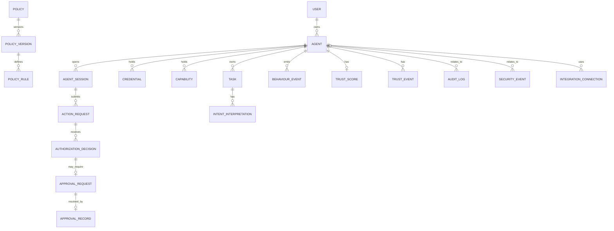

# Database

PROXI uses Supabase PostgreSQL, SQLAlchemy 2 and Alembic. Only the backend connects to PostgreSQL. Domain records and repository protocols do not import the ORM or driver; the SQLAlchemy adapter translates records inside a caller-owned transaction.

## Configuration and migrations

- In development, set `PROXI_DATABASE_URL` in the process or the gitignored root `.env`. Use the PostgreSQL connection details from the Supabase Connect panel, not the project API URL or an API key. Use the direct connection or session pooler and the `postgresql+psycopg` scheme. URL-encode credentials and configure `sslmode=verify-full` with a trusted CA (see [.env.example](../.env.example)). Do not expose the DSN to the frontend or put it in Alembic configuration.
- Use a role with DDL permissions for migrations. In hosted environments, give the runtime role only the required schema and table privileges. Keep the `proxi` schema out of the Supabase Data API's exposed schemas. Do not give the runtime role update/delete permission on history tables if append-only access must be enforced at the database level.
- From `backend`, after [installing dependencies](DEVELOPMENT.md#backend), set the migration DSN and run:

```powershell
..\.venv\Scripts\python.exe -m alembic upgrade head
..\.venv\Scripts\python.exe -m alembic current
..\.venv\Scripts\python.exe -m alembic check
```

Alembic manages the `proxi` schema, including its own version table. App startup does not migrate or verify database connectivity; the liveness endpoint works without a DSN. The initial downgrade drops PROXI tables and their data. Verify downgrades only against disposable databases unless explicitly approved and backed up.

In testing, PROXI ignores the root `.env` and does not fall back to `PROXI_DATABASE_URL`. Use an independent local PostgreSQL instance and set `PROXI_TEST_DATABASE_URL` in the shell. See [isolated test setup](DEVELOPMENT.md#backend).

## Logical relationships

Key foreign keys are shown; nullable context links are omitted for readability.



## Lifecycle and integrity

- UUID primary keys, restrictive foreign keys, uniqueness/check constraints and indexes support lookups and preserve references. Persist timezone-aware timestamps; repositories reject naive values and normalize read/write timestamps to UTC. Row metadata has insert defaults and ORM-managed updates.
- Keep inactive, suspended, and revoked agents, revoked sessions, and expired capabilities as records. Agent IDs are unique and names are unique per owner. Revocation is terminal in the identity service; its active-status check does not authenticate a request.
- Migration `0002` keeps existing agent IDs and maps `disabled` to `inactive` and `deleted` to `revoked`. Legacy `type`, `description`, and `last_seen_at` start `NULL`. Downgrading to `0001` drops those three fields and maps `inactive` and `suspended` to `disabled` and `revoked` to `deleted`; it cannot restore the distinction between inactive and suspended.
- Revision `0003` adds restrictive session foreign keys to credentials and capabilities and a task foreign key to capabilities. The new columns are nullable for legacy rows; the access gate rejects unbound or non-expiring legacy records and cross-agent bindings. Downgrading to `0002` drops these bindings. New JWT records store a non-secret `jwt:<uuid>` reference, not the token.
- Revision `0004` adds optional JSONB `proposal` and `failure_code` to intent interpretations, preserving legacy rows. New successful interpretations store a proposal; failed interpretations store only a failure code and no proposal. A new intent attempt and its task are persisted together. Downgrading drops the proposal and failure details and maps `failed` interpretations to `rejected`.
- Policy versions retain their rules and history. At most one version per policy may be active; a superseded version must carry its supersession timestamp.
- Audit logs and other historical records expose no update or delete through their repositories. Restrictive foreign keys prevent parent deletion from cascading into audit history. Direct writes by privileged roles remain possible. Credential records hold references, not secret material.
